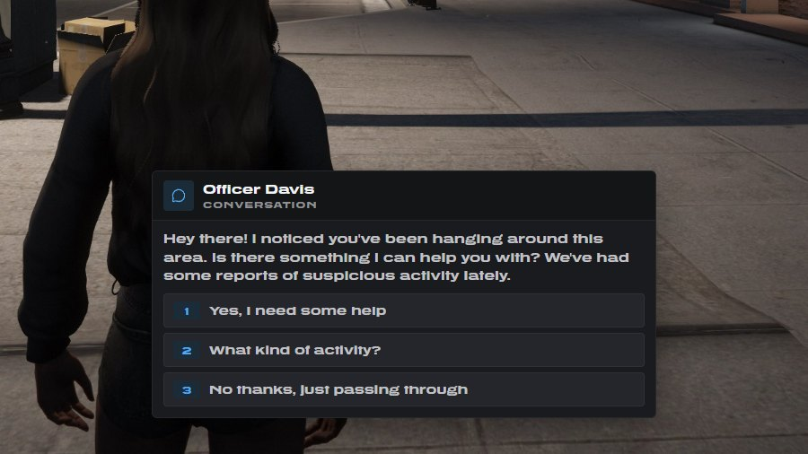
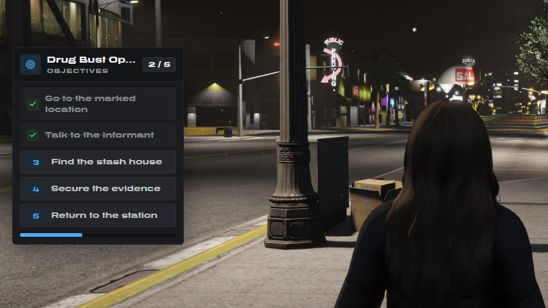
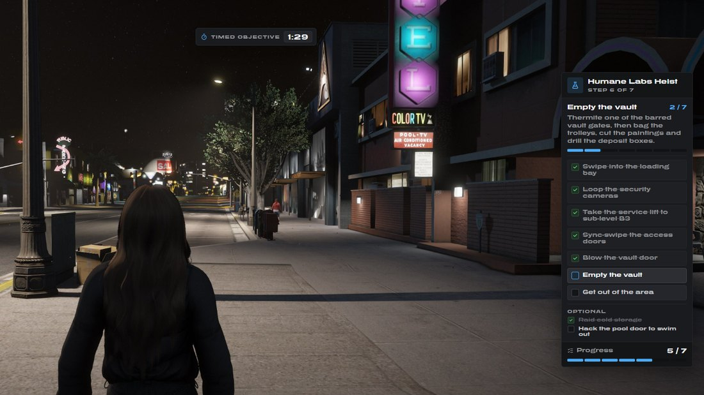
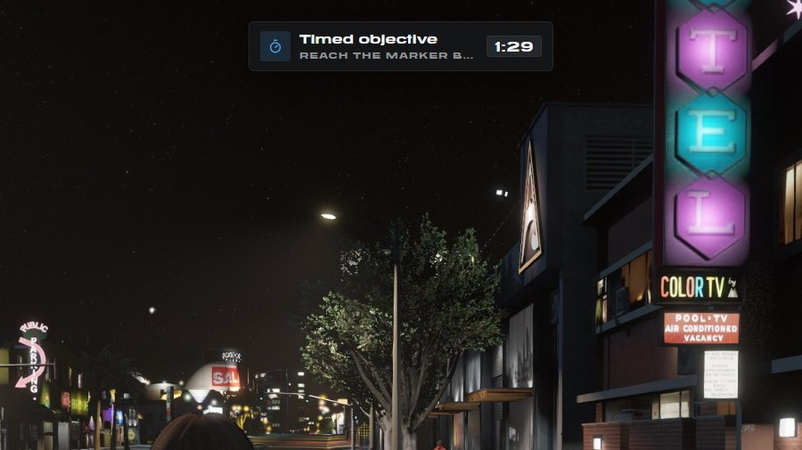
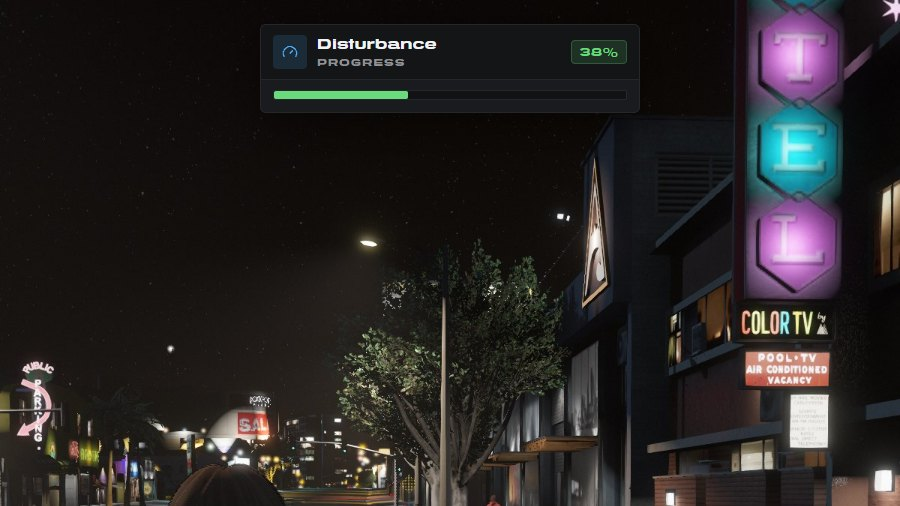
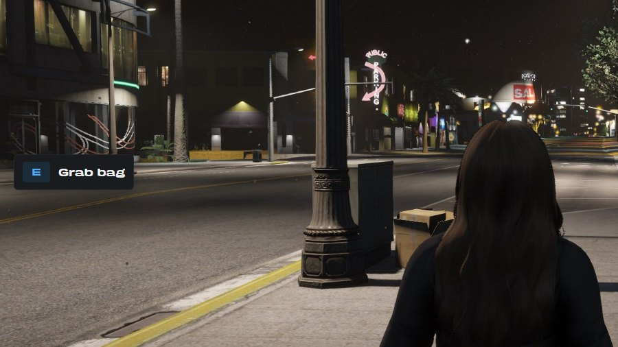
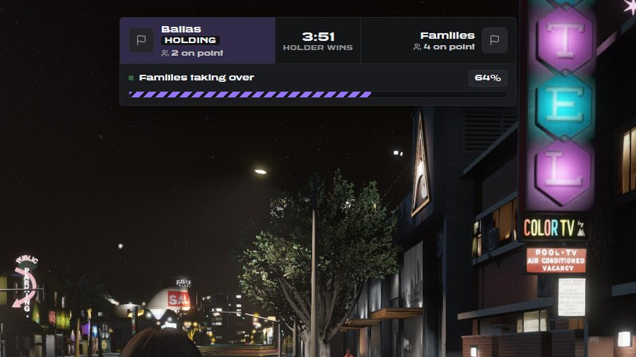

# at-lib exports

Every client and server export at-lib has, with the options of each minigame. For install steps and screenshots see the [README](README.md).

- [Minigames](#minigames)
- [Every minigame](#every-minigame)
- [Search and Ped Loot](#search-and-ped-loot)
- [HUD exports](#dialogue)
- [Dev tools](#dev-tools)

## Minigames

```lua
-- Generic
local ok = exports['at-lib']:Play('arrows', { difficulty = 'easy' })

-- Named export with options
local ok = exports['at-lib']:Arrows({
    difficulty = 'hard',
    numberOfArrows = 14,
    timeLimit = 6,
})

-- Cancel whatever is running
exports['at-lib']:CancelGame()

-- Look up ids and presets
local ids = exports['at-lib']:GetMinigames()
local presets = exports['at-lib']:GetPresets('arrows') -- { easy = {...}, medium = {...}, hard = {...} }
```

- Every game blocks until it ends and returns `true` on success and `false` on failure, timeout or Esc. Search and Ped Loot also return the items found.
- `difficulty` takes `'easy'`, `'medium'` (default), `'hard'` or a number from 1 to 5 (1-2 is easy, 3 is medium, 4-5 is hard).
- Any option you pass wins over the preset. Times are in milliseconds, and values below 1000 are read as seconds.
- Presets live in `modules/minigames/config.lua` under `Config.Presets`.
- Only one game runs at a time.

### Option aliases

| Alias | Same as |
|-------|---------|
| `numberOfStages` | `stages` |
| `timeLimit`, `timePerStage`, `stageTime`, `gameTime` | `duration` |
| `penaltySeconds` | `penalty` |
| `numberOfArrows`, `numberOfKeys` | `length` / `rounds` |
| `numberOfDots` | `dots` |
| `numberOfClicks`, `numberOfHits` | `hitsRequired` |
| `gridSize` | `size` |
| `incorrect` | `oddCount` |
| `subtlety` | `visibility` |
| `targetNumber` | `target` |
| `previewTime` | `preview` |
| `maxFails` | `lives` |

## Every minigame

The tables show the preset for each difficulty. Pass any of these options to override it.

### Hacking

#### Decrypt

Find the token in a stream of scrambled lines and type it in.

Export `Decrypt` · id `decrypt` · Controls: Type, Enter, Esc to quit

| Option | Easy | Medium | Hard |
|--------|------|--------|------|
| `rounds` | 3 | 5 | 6 |
| `tokenLength` | 5 | 6 | 8 |
| `duration` | 35000 | 28000 | 22000 |

```lua
local ok = exports['at-lib']:Decrypt({ difficulty = 'medium' })
```

#### Keypad

Crack a numeric code. Each guess shows which digits are right.

Export `Keypad` · id `keypad` · Controls: 0-9, Enter, Backspace, Esc to quit

| Option | Easy | Medium | Hard |
|--------|------|--------|------|
| `length` | 4 | 4 | 4 |
| `tries` | 8 | 6 | 4 |
| `duration` | 45000 | 35000 | 25000 |

```lua
local ok = exports['at-lib']:Keypad({ difficulty = 'medium' })
```

#### Overflow

Rotate pipe tiles to connect the source to the drain.

Export `Overflow` · id `overflow` · Controls: Click to rotate, Esc to quit

| Option | Easy | Medium | Hard |
|--------|------|--------|------|
| `duration` | 45000 | 35000 | 25000 |

```lua
local ok = exports['at-lib']:Overflow({ difficulty = 'medium' })
```

#### Circuit Flow

Rotate circuit tiles to power every output and avoid the danger tiles.

Export `Circuit` / `PipePressure` · id `circuit` · Controls: Click to rotate, E or Space to confirm, Esc to quit

| Option | Easy | Medium | Hard |
|--------|------|--------|------|
| `size` | 3 | 4 | 5 |
| `sources` | 1 | 1 | 2 |
| `outputs` | 1 | 2 | 3 |
| `dangers` | 0 | 1 | 2 |
| `maxRotations` | 0 | 0 | 18 |
| `duration` | 50000 | 36000 | 26000 |

```lua
local ok = exports['at-lib']:Circuit({ difficulty = 'medium' })
```

#### Port Scan

Click only the OPEN ports as they change. Traps cost time.

Export `PortScan` · id `portscan` · Controls: Click, Esc to quit

| Option | Easy | Medium | Hard |
|--------|------|--------|------|
| `ports` | 8 | 12 | 16 |
| `required` | 3 | 5 | 7 |
| `tick` | 1100 | 750 | 480 |
| `trapPenalty` | 2500 | 3500 | 5000 |
| `similar` | false | true | true |
| `duration` | 40000 | 28000 | 20000 |

```lua
local ok = exports['at-lib']:PortScan({ difficulty = 'medium' })
```

#### Data Crack

Stop each moving column when its gap lines up with the scan line.

Export `DataCrack` · id `datacrack` · Controls: E, Space or click, Esc to quit

| Option | Easy | Medium | Hard |
|--------|------|--------|------|
| `numberOfStages` | 1 | 2 | 3 |
| `segments` | 6 | 8 | 10 |
| `segmentSpeed` | 45 | 60 | 85 |
| `gapSize` | 26 | 22 | 17 |

```lua
local ok = exports['at-lib']:DataCrack({ difficulty = 'medium' })
```

#### Signal Tune

Tune frequency, amplitude and phase until your wave matches the target.

Export `SignalTune` · id `signaltune` · Controls: Sliders, E or Space to lock, Esc to quit

| Option | Easy | Medium | Hard |
|--------|------|--------|------|
| `freqTolerance` | 0.45 | 0.28 | 0.16 |
| `ampTolerance` | 10 | 6 | 4 |
| `phaseTolerance` | 22 | 12 | 7 |
| `duration` | 45000 | 32000 | 22000 |

```lua
local ok = exports['at-lib']:SignalTune({ difficulty = 'medium' })
```

#### Binary Code

Memorise a row of bits, then type it back. Hard reverses it and adds glitches.

Export `Binary` · id `binary` · Controls: 0 / 1 keys, Esc to quit

| Option | Easy | Medium | Hard |
|--------|------|--------|------|
| `length` | 6 | 8 | 10 |
| `preview` | 3200 | 2100 | 1400 |
| `reverse` | false | false | true |
| `glitches` | false | true | true |
| `duration` | 40000 | 28000 | 20000 |

```lua
local ok = exports['at-lib']:Binary({ difficulty = 'medium' })
```

#### Sequence

Find the letter sequence hidden in a grid that keeps scrambling.

Export `Sequence` · id `sequence` · Controls: WASD or arrows, Enter, Esc to quit

| Option | Easy | Medium | Hard |
|--------|------|--------|------|
| `stages` | 1 | 2 | 3 |
| `gridSize` | 6 | 8 | 10 |
| `sequenceLength` | 3 | 4 | 5 |
| `duration` | 28000 | 20000 | 13000 |
| `penalty` | 2000 | 3000 | 4000 |
| `scrambleCount` | 0 | 1 | 3 |
| `instantFail` | false | false | true |

```lua
local ok = exports['at-lib']:Sequence({ difficulty = 'medium' })
```

#### Color Match

Remember a colour, then mix it again with RGB sliders.

Export `ColorMatch` / `ChromaLock` · id `colormatch` · Controls: Sliders, submit, Esc to quit

| Option | Easy | Medium | Hard |
|--------|------|--------|------|
| `preview` | 3500 | 2200 | 1300 |
| `tolerance` | 55 | 32 | 18 |
| `duration` | 40000 | 28000 | 20000 |
| `stages` | 1 | 1 | 2 |

```lua
local ok = exports['at-lib']:ColorMatch({ difficulty = 'medium' })
```

#### Laser Grid

Move through a room of sweeping lasers to the exit without being detected.

Export `LaserGrid` · id `lasergrid` · Controls: WASD, Esc to quit

| Option | Easy | Medium | Hard |
|--------|------|--------|------|
| `laserCount` | 3 | 4 | 6 |
| `laserSpeed` | 14 | 20 | 28 |
| `sections` | 1 | 2 | 2 |
| `detectionHits` | 5 | 4 | 3 |
| `fog` | false | false | true |
| `cameraSway` | false | false | false |
| `duration` | 50000 | 45000 | 42000 |

```lua
local ok = exports['at-lib']:LaserGrid({ difficulty = 'medium' })
```

#### Pathing

Link the dots from the start, always to the closest one.

Export `Pathing` · id `pathing` · Controls: Drag, click, Esc to quit

| Option | Easy | Medium | Hard |
|--------|------|--------|------|
| `stages` | 1 | 2 | 3 |
| `dots` | 5 | 7 | 9 |
| `duration` | 25000 | 18000 | 12000 |

```lua
local ok = exports['at-lib']:Pathing({ difficulty = 'medium' })
```

#### Untangle

Drag the dots until no wires cross.

Export `Untangle` / `AMess` · id `untangle` · Controls: Drag, Esc to quit

| Option | Easy | Medium | Hard |
|--------|------|--------|------|
| `dots` | 5 | 7 | 9 |
| `duration` | 50000 | 40000 | 30000 |
| `stages` | 1 | 1 | 2 |

```lua
local ok = exports['at-lib']:Untangle({ difficulty = 'medium' })
```

#### Wires

Connect each wire to the terminal of the same colour.

Export `Wires` · id `wires` · Controls: Drag, Esc to quit

| Option | Easy | Medium | Hard |
|--------|------|--------|------|
| `wires` | 3 | 4 | 5 |
| `duration` | 45000 | 32000 | 22000 |

```lua
local ok = exports['at-lib']:Wires({ difficulty = 'medium' })
```

#### Merge

Slide and merge tiles until you reach the target number.

Export `Merge` / `Game20471` · id `merge` · Controls: WASD or arrows, Esc to quit

| Option | Easy | Medium | Hard |
|--------|------|--------|------|
| `target` | 64 | 128 | 256 |
| `duration` | 50000 | 40000 | 30000 |
| `stages` | 1 | 1 | 2 |

```lua
local ok = exports['at-lib']:Merge({ difficulty = 'medium' })
```

### Memory and puzzles

#### Remember

Watch which cells light up, then click the same cells.

Export `Remember` · id `remember` · Controls: Click, Esc to quit

| Option | Easy | Medium | Hard |
|--------|------|--------|------|
| `targets` | 4 | 6 | 8 |
| `lives` | 1 | 1 | 1 |
| `preview` | 4000 | 3000 | 2000 |
| `duration` | 18000 | 14000 | 10000 |

```lua
local ok = exports['at-lib']:Remember({ difficulty = 'medium' })
```

#### Pairs

Flip cards and find every matching pair.

Export `Pairs` · id `pairs` · Controls: Click, Esc to quit

| Option | Easy | Medium | Hard |
|--------|------|--------|------|
| `pairs` | 4 | 8 | 10 |
| `duration` | 50000 | 36000 | 22000 |
| `stages` | 1 | 1 | 2 |

```lua
local ok = exports['at-lib']:Pairs({ difficulty = 'medium' })
```

#### Odd One Out

Spot the symbol that is different from the rest.

Export `OddOneOut` · id `oddoneout` · Controls: Click, Esc to quit

| Option | Easy | Medium | Hard |
|--------|------|--------|------|
| `size` | 3 | 4 | 6 |
| `oddCount` | 1 | 1 | 2 |
| `visibility` | 1 | 3 | 5 |
| `animated` | false | false | true |
| `stages` | 1 | 2 | 3 |
| `lives` | 2 | 1 | 1 |
| `duration` | 20000 | 13000 | 9000 |

```lua
local ok = exports['at-lib']:OddOneOut({ difficulty = 'medium' })
```

### Locks, safes and drills

#### Safe Crack

Turn the dial and find each number of the combination.

Export `SafeCrack` · id `safecrack` · Controls: A / D or scroll, Enter, Esc to quit

| Option | Easy | Medium | Hard |
|--------|------|--------|------|
| `rounds` | 2 | 3 | 5 |
| `tries` | 5 | 3 | 2 |
| `duration` | 90000 | 75000 | 90000 |

```lua
local ok = exports['at-lib']:SafeCrack({ difficulty = 'medium' })
```

#### Lockpick

Tap the numbered nodes in order before they fade.

Export `Lockpick` · id `lockpick` · Controls: Click, Esc to quit

| Option | Easy | Medium | Hard |
|--------|------|--------|------|
| `nodes` | 3 | 4 | 6 |
| `spinTolerance` | 16 | 12 | 8 |
| `nodeLifetime` | 2200 | 1600 | 1100 |
| `duration` | 40000 | 32000 | 24000 |

```lua
local ok = exports['at-lib']:Lockpick({ difficulty = 'medium' })
```

#### Lockpick V2

Press when the needle is on a green segment and avoid the red ones.

Export `LockpickV2` · id `lockpickv2` · Controls: E or Space, Esc to quit

| Option | Easy | Medium | Hard |
|--------|------|--------|------|
| `segments` | 7 | 8 | 10 |
| `greenCount` | 4 | 4 | 3 |
| `emptyCount` | | | |
| `speed` | 110 | 130 | 190 |
| `lives` | 3 | 2 | 1 |
| `duration` | 0 (no timer) | 0 (no timer) | 0 (no timer) |

```lua
local ok = exports['at-lib']:LockpickV2({ difficulty = 'medium' })
```

#### Circle Lock

Press when the spinning needle hits the zone, several times in a row.

Export `CircleLock` / `CircleClick` · id `circlelock` · Controls: E or Space, Esc to quit

| Option | Easy | Medium | Hard |
|--------|------|--------|------|
| `stages` | 2 | 3 | 5 |
| `zoneSize` | 48 | 34 | 22 |
| `speed` | 120 | 180 | 260 |
| `lives` | 3 | 2 | 1 |

```lua
local ok = exports['at-lib']:CircleLock({ difficulty = 'medium' })
```

#### Pin Tension

Hold the tension and lift each pin until both are in their zones.

Export `PinTension` · id `pintension` · Controls: A / D tension, W / S lift, Esc to quit

| Option | Easy | Medium | Hard |
|--------|------|--------|------|
| `pins` | 3 | 4 | 6 |
| `zoneSize` | 14 | 10 | 6 |
| `tensionTol` | 16 | 12 | 8 |
| `durability` | 5 | 3 | 2 |
| `fallSpeed` | 28 | 42 | 64 |

```lua
local ok = exports['at-lib']:PinTension({ difficulty = 'medium' })
```

#### Pin Lock

Raise each pin against gravity and set it in the zone.

Export `PinLock` · id `pinlock` · Controls: Space to raise, E to set, Esc to quit

| Option | Easy | Medium | Hard |
|--------|------|--------|------|
| `numberOfPins` | 4 | 6 | 8 |
| `gravity` | 115 | 140 | 180 |
| `zoneTolerance` | 9 | 7 | 4 |
| `maxAttempts` | 5 | 3 | 1 |
| `instantFail` | false | false | true |

```lua
local ok = exports['at-lib']:PinLock({ difficulty = 'medium' })
```

#### Notch

Press as the rotating arm passes each notch.

Export `Notch` · id `notch` · Controls: E, Esc to quit

| Option | Easy | Medium | Hard |
|--------|------|--------|------|
| `notches` | 3 | 4 | 5 |
| `speed` | 90 | 130 | 180 |
| `tolerance` | 16 | 12 | 8 |
| `duration` | 25000 | 20000 | 16000 |

```lua
local ok = exports['at-lib']:Notch({ difficulty = 'medium' })
```

#### Drill

Move the drill bit into the lane whose colour matches the falling bar.

Export `Drill` · id `drill` · Controls: Arrows or A / D, Esc to quit

| Option | Easy | Medium | Hard |
|--------|------|--------|------|
| `hitsRequired` | 5 | 9 | 12 |
| `fallMs` | 3200 | 2400 | 1700 |

```lua
local ok = exports['at-lib']:Drill({ difficulty = 'medium' })
```

#### Stacker

Drop each moving block on the stack. Overhang is cut off.

Export `Stacker` · id `stacker` · Controls: Space, Enter or click, Esc to quit

| Option | Easy | Medium | Hard |
|--------|------|--------|------|
| `numberOfStages` | 1 | 1 | 2 |
| `rowsToGoal` | 5 | 7 | 9 |
| `startWidthPercent` | 50 | 40 | 32 |
| `segmentSpeed` | 50 | 70 | 90 |
| `speedUpEachRow` | false | true | true |

```lua
local ok = exports['at-lib']:Stacker({ difficulty = 'medium' })
```

### Skill checks

#### Skill Bar

Press when the marker is inside the zone.

Export `SkillBar` · id `skillbar` · Controls: E, Esc to quit

| Option | Easy | Medium | Hard |
|--------|------|--------|------|
| `segmentSpeed` | 55 | 90 | 135 |
| `targetZoneSize` | 22 | 14 | 8 |
| `hitsRequired` | 2 | 3 | 5 |

```lua
local ok = exports['at-lib']:SkillBar({ difficulty = 'medium' })
```

#### Pulse Bar

Several markers cross the bar. Press as each one reaches the zone.

Export `PulseBar` · id `pulsebar` · Controls: E, Esc to quit

| Option | Easy | Medium | Hard |
|--------|------|--------|------|
| `segmentSpeed` | 32 | 45 | 62 |
| `targetZoneSize` | 16 | 12 | 8 |
| `numberOfSegments` | 3 | 4 | 6 |

```lua
local ok = exports['at-lib']:PulseBar({ difficulty = 'medium' })
```

#### Smash

Mash the key to fill the bar before it drains.

Export `Smash` · id `smash` · Controls: E (configurable), Esc to quit

| Option | Easy | Medium | Hard |
|--------|------|--------|------|
| `key` | 'E' | 'E' | 'E' |
| `gain` | 12 | 8 | 5 |
| `decay` | 8 | 15 | 26 |
| `duration` | 20000 | 14000 | 10000 |

```lua
local ok = exports['at-lib']:Smash({ difficulty = 'medium' })
```

#### Arrows

Press the arrow sequence in order before time runs out.

Export `Arrows` · id `arrows` · Controls: Arrow keys, Esc to quit

| Option | Easy | Medium | Hard |
|--------|------|--------|------|
| `length` | 5 | 8 | 12 |
| `stages` | 1 | 1 | 1 |
| `duration` | 12000 | 8000 | 5500 |

```lua
local ok = exports['at-lib']:Arrows({ difficulty = 'medium' })
```

#### Alphabet

Type the letters in order as fast as you can.

Export `Alphabet` / `Keys` · id `alphabet` · Controls: Letter keys, Esc to quit

| Option | Easy | Medium | Hard |
|--------|------|--------|------|
| `rounds` | 8 | 15 | 22 |
| `duration` | 12000 | 10000 | 8000 |

```lua
local ok = exports['at-lib']:Alphabet({ difficulty = 'medium' })
```

### Looting (ox_inventory)

#### Search

Search boxes one by one. Items found go to the player through ox_inventory.

Export `Search` · id `search` · Controls: Click, Esc to quit

| Option | Easy | Medium | Hard |
|--------|------|--------|------|
| `itemCount` | 3 | 4 | 6 |
| `required` | 2 | 3 | 4 |
| `searchTime` | 900 | 1400 | 2000 |
| `duration` | 35000 | 26000 | 18000 |

```lua
local ok = exports['at-lib']:Search({ difficulty = 'medium' })
```

#### Ped Loot

Grab each loot slot as the marker passes it and skip the empty ones.

Export `PedLoot` · id `pedloot` · Controls: Space, Esc to quit

| Option | Easy | Medium | Hard |
|--------|------|--------|------|
| `slots` | 4 | 5 | 6 |
| `empties` | 1 | 2 | 3 |
| `speed` | 55 | 90 | 130 |
| `duration` | 22000 | 15000 | 11000 |

```lua
local ok = exports['at-lib']:PedLoot({ difficulty = 'medium' })
```


## Search and Ped Loot

Search and Ped Loot give items through ox_inventory. The **server decides what can be given**: call `AllowLoot` from your server script before you start the game on that player. The player can then receive up to those items from their next Search or Ped Loot, for 10 minutes. Anything the client asks for outside that list is ignored, so cheaters cannot give themselves items.

```lua
-- server.lua of your resource
RegisterNetEvent('myjob:searchCrate', function(crateId)
    local src = source
    -- your own checks first: distance, cooldown, job, crate not already looted
    local loot = {
        { item = 'lockpick', count = 1 },
        { item = 'money', count = 250 },
        { item = 'phone', count = 1 },
    }
    exports['at-lib']:AllowLoot(src, loot)
    TriggerClientEvent('myjob:openCrate', src, loot)
end)
```

```lua
-- client.lua of your resource
RegisterNetEvent('myjob:openCrate', function(loot)
    local ok, found = exports['at-lib']:Search({
        difficulty = 'medium',
        items = loot,
        required = 2,       -- slots to find to count as a success
        searchTime = 1400,  -- ms per box
        timeLimit = 26,     -- seconds
    })
    -- items are already in the inventory. ok is false on timeout or Esc,
    -- and found still lists what the player opened before that.
end)

local ok, found = exports['at-lib']:PedLoot({ difficulty = 'medium', slots = 5, empties = 2 })
```

| Export (server) | Parameters | Returns |
|-----------------|------------|---------|
| `AllowLoot` | `source, items` with `{ item, count?, metadata? }` | `boolean` |

- Pass `grantItems = false` to Search or Ped Loot to give nothing and handle the items yourself from the returned list.
- Metadata comes from the `AllowLoot` list, never from the client.
- For a quick test without server code, `setr at_lib_client_loot true` accepts the list the client sends, which is how rm-lib worked. Never turn it on for a live server: any player could give themselves any item.

## Dialogue



Opens a dialogue box and takes NUI focus. The callback gets the chosen option id, or `nil` when the player closes it.

| Export | Parameters | Returns |
|--------|------------|---------|
| `dialogue` | `data, cb?` | |
| `closeDialogue` | | |
| `isDialogueOpen` | | `boolean` |
| `getDialogue` | | current data or `nil` |

```lua
exports['at-lib']:dialogue({
    name = 'Officer Davis',
    text = 'We need your help with a case. Are you in?',
    ped = npcPed, -- optional, points a camera at this NPC
    options = {
        { id = 'accept', label = "Yes, I'm in" },
        { id = 'decline', label = 'Not right now' },
    },
}, function(optionId)
    if optionId == 'accept' then
        -- start the job
    end
end)
```

## Mission status



Left side panel with a title and a list of objectives. Does not take NUI focus.

| Export | Parameters |
|--------|------------|
| `setMission` | `data` |
| `updateObjective` | `objectiveId, completed` |
| `updateObjectives` | `objectives` |
| `closeMission` | |
| `getMission` | |
| `isMissionActive` | |

```lua
exports['at-lib']:setMission({
    title = 'Drug Bust Operation',
    objectives = {
        { id = 'goto', label = 'Go to the marked location', completed = false },
        { id = 'talk', label = 'Talk to the informant', completed = false },
    },
})

exports['at-lib']:updateObjective('goto', true)
exports['at-lib']:closeMission()
```

## Mission card



Compact card in the top right. It takes the same data as `setMission` and can be shown on its own or next to the panel.

| Export | Parameters |
|--------|------------|
| `setMissionCard` | `data` |
| `updateMissionCardDetails` | `data` |
| `updateObjectiveCard` | `objectiveId, completed` |
| `updateObjectivesCard` | `objectives` |
| `closeMissionCard` | |
| `getMissionCard` | |
| `isMissionCardActive` | |

| Field | Type | Description |
|-------|------|-------------|
| `title` | `string` | Mission title. |
| `objectives` | `table[]` | `{ id, label, completed }`. Required unless `steps` is given. |
| `steps` | `table[]?` | `{ id?, label, done?, active?, progress?, count? }`, replaces `objectives`. |
| `optional` | `table[]?` | `{ id?, label, done? }` under an Optional heading. |
| `task` | `string?` | Current step heading. |
| `detail` | `string?` | Current step description. |
| `meta` | `string?` | Line under the title, defaults to `Step X of N`. |
| `icon` | `string?` | Lucide icon name from `web/src/lib/icons.ts`. |
| `tasks` | `table[]?` | `{ id?, label, done?, progress?, count? }` checklist under the current step. |
| `badge` | `table?` | `{ icon?, text }` shown in the header. |
| `gauges` | `table[]?` | `{ id?, label?, icon?, kind = 'bar' \| 'segments' \| 'text', value?, max?, tone?, text?, ttl? }`. |
| `stat` | `table?` | `{ id?, label, value, icon?, format? = 'money' \| 'number' }` footer value. |
| `hint` | `string?` | Highlighted line at the bottom. |

`updateMissionCardDetails` accepts any of the fields above except `title` and `objectives`. `updateObjectiveCard` also matches `steps`, `tasks` and `optional` entries by id.

```lua
exports['at-lib']:setMissionCard({
    title = 'Delivery run',
    icon = 'truck',
    objectives = {
        { id = 'meet', label = 'Meet the buyer at the GPS mark', completed = false },
        { id = 'return', label = 'Return to the depot for payment', completed = false },
    },
})

exports['at-lib']:updateObjectiveCard('meet', true)
exports['at-lib']:closeMissionCard()
```

## Timers



A top-centre countdown. The callback runs once when it reaches zero and does not run if you close the timer first.

| Export | Parameters |
|--------|------------|
| `showTimer` | `{ seconds, header?, text? }, cb?` |
| `updateTimer` | `{ seconds?, header?, text? }` |
| `closeTimer` | |

```lua
exports['at-lib']:showTimer({
    seconds = 300,
    header = 'Timed objective',
    text = 'Reach the drop-off before time runs out.',
}, function()
    exports['at-lib']:closeMission()
end)

exports['at-lib']:updateTimer({ seconds = 120, text = 'Two minutes left' })
exports['at-lib']:closeTimer()
```

The heist timer is a compact `MM:SS` display that sits above the mission card:

```lua
exports['at-lib']:showTimedObjectiveV2({ seconds = 35 * 60 }, function()
    print('Heist time expired')
end)

exports['at-lib']:updateTimedObjectiveV2({ seconds = 120 })
exports['at-lib']:closeTimedObjectiveV2()
```

## Progress bar



Bottom-centre bar from 0 to 100.

```lua
exports['at-lib']:showProgress({ progress = 25, header = 'Suspicion', label = 'Stay out of sight' })
exports['at-lib']:updateProgress({ progress = 80 })
exports['at-lib']:closeProgress()
```

## TextUI



Key prompt on the right side of the screen. Does not take NUI focus.

```lua
exports['at-lib']:showTextUI('E', 'Grab bag')      -- key and label
exports['at-lib']:showTextUI('Hold to search')     -- plain label, no key
local open = exports['at-lib']:isTextUIOpen()
exports['at-lib']:hideTextUI()
```

## Gang zone



Top-centre capture card. The side that owns or is capturing the zone gets its gang colour, and `owner = nil` shows the zone as contested.

```lua
exports['at-lib']:showGangZone({
    percent = 40,
    seconds = 90,
    left = { name = 'Ballas', logo = 'https://example.com/ballas.png', color = '#7b2fbe' },
    right = { name = 'Families', color = '#2f9e44' },
    owner = 'left',
})

exports['at-lib']:updateGangZone({ percent = 55, seconds = 75 })
exports['at-lib']:closeGangZone()
```

## World cards

A small icon and label drawn by the game at a world position or on an entity, visible within `distance` metres.

```lua
local id = exports['at-lib']:addWorldCard({
    coords = vec3(x, y, z),    -- or entity = vehicle, offset = vec3(0.0, -4.0, 1.2)
    label = 'Locked',
    icon = 'lock',             -- lock, lock-open, trash-2, truck, banknote, trees, hard-hat, package, check, user
    color = 'red',             -- red, green, blue, orange or grey
    distance = 2.0,
    showWhileMoving = false,   -- vehicle cards hide while driving unless true
})

exports['at-lib']:updateWorldCard(id, { label = 'Unlocked', icon = 'lock-open', color = 'green' })
exports['at-lib']:removeWorldCard(id)
```

## Helpers

```lua
local ped = exports['at-lib']:getPlayerPed() -- cache.ped from ox_lib
```

## Dev tools

```bash
setr at_minigames_dev true
```

With the convar on, `/minigames` opens a picker with every game and difficulty, and `/test<game> [easy|medium|hard]` runs one game, for example `/testarrows hard`. Exports always work: only the commands are gated.

`InitializeSafe(combination, startDirection)` followed by `RunMiniGame()` is also available for scripts written for other safe-cracking resources.
