# AT Lib

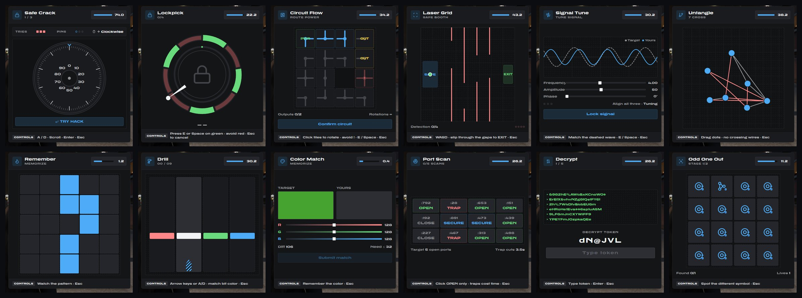

at-lib is a free UI library for FiveM. It gives your scripts one shared set of HUD pieces and **34 minigames**: NPC dialogue, mission panels, timers, progress bars, key prompts, gang zone capture cards, status cards pinned in the world, and minigames for hacking, lockpicking, safe cracking, skill checks and looting. Everything is a client export, so any resource can use it with one line of Lua. The interface is built with Svelte 5 and ships prebuilt, so there is nothing to compile.

It has no framework dependency and works on Qbox, QBCore, ESX or a standalone server.

**Free and open source.** Docs: [studio.atleast.lv/docs/at-lib](https://studio.atleast.lv/docs/at-lib) · Support: [Discord](https://dsc.gg/rm-scripts)

## What's inside

### HUD

| Piece | What it does | Main exports |
|-------|--------------|--------------|
| Dialogue | NPC name, text and answer buttons, with an optional camera on the NPC | `dialogue`, `closeDialogue` |
| Mission status | Left-side panel with a title and objectives | `setMission`, `updateObjective` |
| Mission card | Top-right card with steps, tasks, optional objectives, gauges, a stat and a hint | `setMissionCard`, `updateMissionCardDetails` |
| Timer | Top-centre countdown with a callback when it runs out | `showTimer`, `updateTimer` |
| Heist timer | Compact `MM:SS` timer above the mission card | `showTimedObjectiveV2` |
| Progress bar | 0 to 100 bar for noise, suspicion, hack progress and the like | `showProgress`, `updateProgress` |
| TextUI | Key prompt such as `[E] Grab bag`, without NUI focus | `showTextUI`, `hideTextUI` |
| Gang zone | Capture card with both gangs, the capture percentage and the time left | `showGangZone`, `updateGangZone` |
| World cards | Icon and label drawn at a spot in the world or on an entity | `addWorldCard`, `updateWorldCard` |

### Minigames

| Group | Games |
|-------|-------|
| Hacking | Decrypt, Keypad, Overflow, Circuit Flow, Port Scan, Data Crack, Signal Tune, Binary Code, Sequence, Color Match, Laser Grid, Pathing, Untangle, Wires, Merge |
| Memory and puzzles | Remember, Pairs, Odd One Out |
| Locks, safes and drills | Safe Crack, Lockpick, Lockpick V2, Circle Lock, Pin Tension, Pin Lock, Notch, Drill, Stacker |
| Skill checks | Skill Bar, Pulse Bar, Smash, Arrows, Alphabet |
| Looting (ox_inventory) | Search, Ped Loot |

Every game has easy, medium and hard presets, a numeric difficulty from 1 to 5, and options you can override one by one.

### Tools

- `Play(id, options)` runs any game by id, and every game also has its own named export.
- `CancelGame`, `GetMinigames` and `GetPresets` for scripts that manage games.
- `InitializeSafe` and `RunMiniGame` for scripts written for other safe-cracking resources.
- A dev menu and a `/test<game>` command for every game, behind a convar.

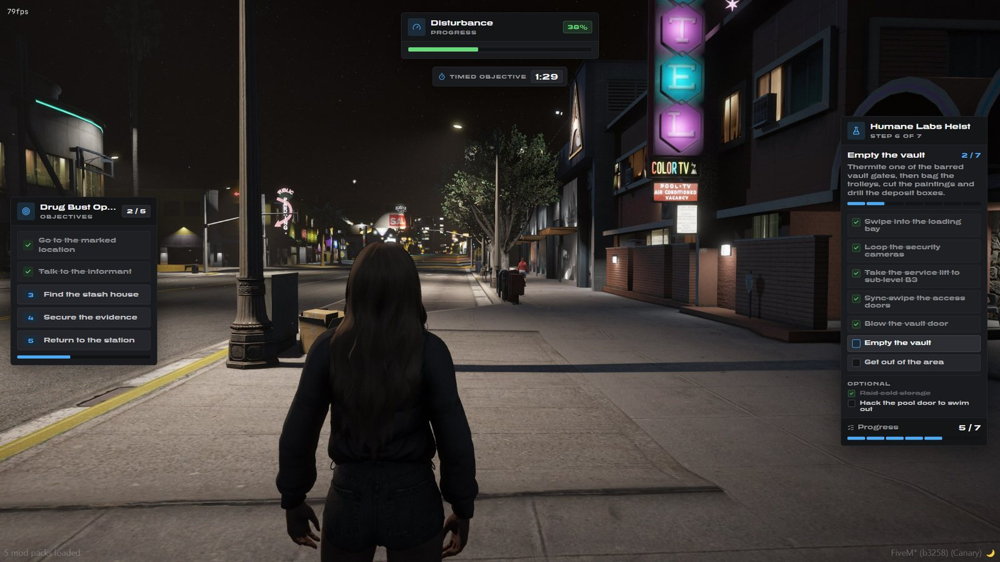

## Requirements

- [ox_lib](https://github.com/overextended/ox_lib)
- [ox_inventory](https://github.com/overextended/ox_inventory), only for the Search and Ped Loot minigames

## Installation

1. Download the latest release and put the `at-lib` folder in your `resources` directory.
2. Start it after ox_lib in `server.cfg`:

   ```bash
   ensure ox_lib
   ensure ox_inventory   # only needed for Search and Ped Loot
   ensure at-lib
   ```

3. Start every resource that uses at-lib after it, and add `dependency 'at-lib'` to its `fxmanifest.lua`.

The built UI is already in `web/build`, so a normal install needs no Node.js or build step.

## Quick start

```lua
-- A minigame. Returns true on success, false on fail, timeout or Esc.
if exports['at-lib']:SafeCrack({ difficulty = 'hard' }) then
    print('Safe open')
end

-- Any game by id
local ok = exports['at-lib']:Play('lockpickv2', { difficulty = 'easy' })

-- A key prompt
exports['at-lib']:showTextUI('E', 'Grab bag')

-- A mission card with a heist timer
exports['at-lib']:setMissionCard({
    title = 'Corner store job',
    icon = 'landmark',
    objectives = {
        { id = 'door', label = 'Pick the back door', completed = false },
        { id = 'safe', label = 'Crack the safe', completed = false },
    },
})
exports['at-lib']:showTimedObjectiveV2({ seconds = 600 }, function()
    exports['at-lib']:closeMissionCard()
end)
```

## Minigames

```lua
-- Generic
local ok = exports['at-lib']:Play('arrows', { difficulty = 'easy' })

-- Named export with options
local ok = exports['at-lib']:Arrows({
    difficulty = 'hard',
    numberOfArrows = 14,
    timeLimit = 6,
})

-- Cancel whatever is running
exports['at-lib']:CancelGame()

-- Look up ids and presets
local ids = exports['at-lib']:GetMinigames()
local presets = exports['at-lib']:GetPresets('arrows') -- { easy = {...}, medium = {...}, hard = {...} }
```

- Every game blocks until it ends and returns `true` on success and `false` on failure, timeout or Esc. Search and Ped Loot also return the items found.
- `difficulty` takes `'easy'`, `'medium'` (default), `'hard'` or a number from 1 to 5 (1-2 is easy, 3 is medium, 4-5 is hard).
- Any option you pass wins over the preset. Times are in milliseconds, and values below 1000 are read as seconds.
- Presets live in `modules/minigames/config.lua` under `Config.Presets`.
- Only one game runs at a time.

Option aliases, so code written for other minigame resources keeps working:

| Alias | Same as |
|-------|---------|
| `numberOfStages` | `stages` |
| `timeLimit`, `timePerStage`, `stageTime`, `gameTime` | `duration` |
| `penaltySeconds` | `penalty` |
| `numberOfArrows`, `numberOfKeys` | `length` / `rounds` |
| `numberOfDots` | `dots` |
| `numberOfClicks`, `numberOfHits` | `hitsRequired` |
| `gridSize` | `size` |
| `incorrect` | `oddCount` |
| `subtlety` | `visibility` |
| `targetNumber` | `target` |
| `previewTime` | `preview` |
| `maxFails` | `lives` |

Every game with its options and easy, medium and hard defaults is in [EXPORTS.md](EXPORTS.md).

### Hacking

<table>
<tr>
<td width="33%" valign="top">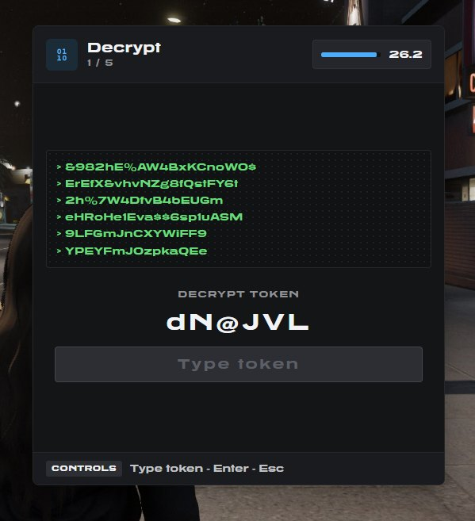<br><b>Decrypt</b> · <code>Decrypt</code><br><sub>Find the token in a stream of scrambled lines and type it in.</sub></td>
<td width="33%" valign="top">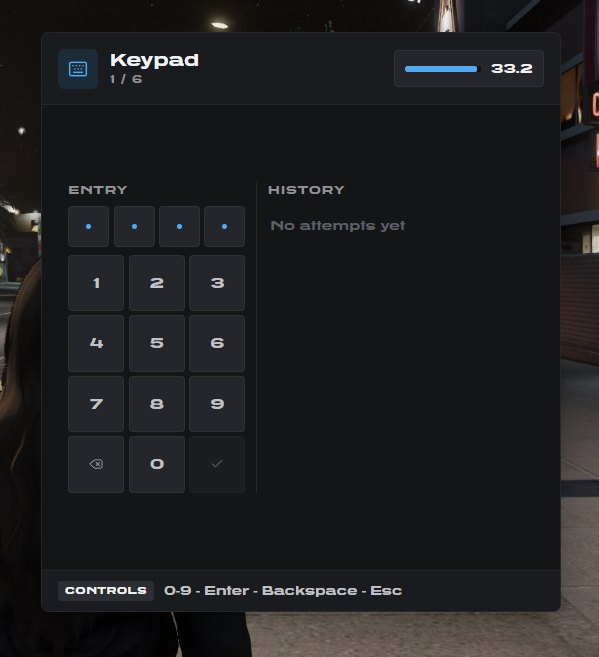<br><b>Keypad</b> · <code>Keypad</code><br><sub>Crack a numeric code. Each guess shows which digits are right.</sub></td>
<td width="33%" valign="top">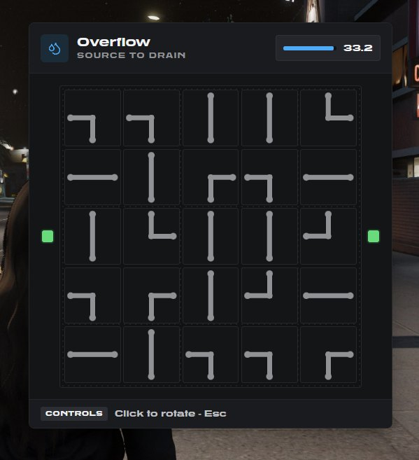<br><b>Overflow</b> · <code>Overflow</code><br><sub>Rotate pipe tiles to connect the source to the drain.</sub></td>
</tr>
<tr>
<td width="33%" valign="top">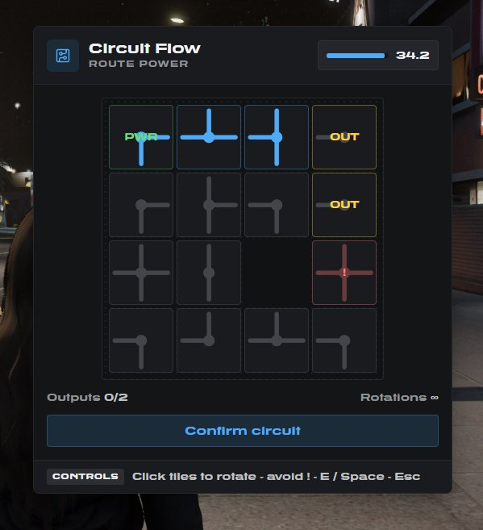<br><b>Circuit Flow</b> · <code>Circuit</code><br><sub>Rotate circuit tiles to power every output and avoid the danger tiles.</sub></td>
<td width="33%" valign="top">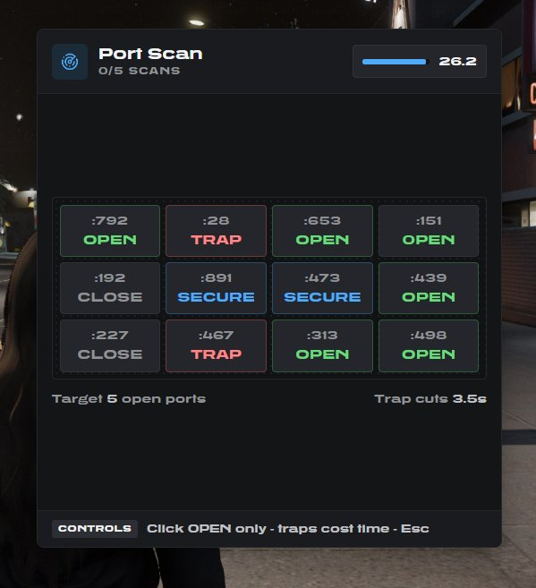<br><b>Port Scan</b> · <code>PortScan</code><br><sub>Click only the OPEN ports as they change. Traps cost time.</sub></td>
<td width="33%" valign="top">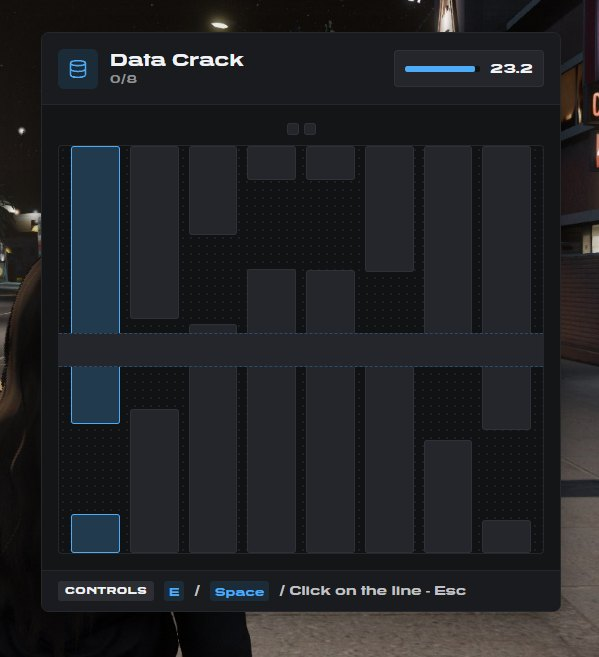<br><b>Data Crack</b> · <code>DataCrack</code><br><sub>Stop each moving column when its gap lines up with the scan line.</sub></td>
</tr>
<tr>
<td width="33%" valign="top">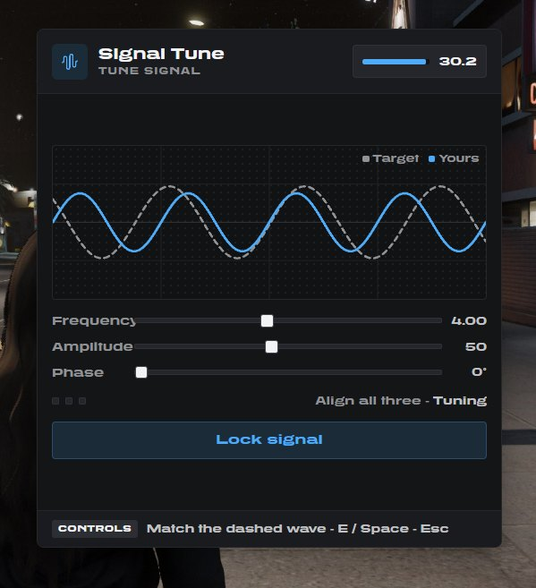<br><b>Signal Tune</b> · <code>SignalTune</code><br><sub>Tune frequency, amplitude and phase until your wave matches the target.</sub></td>
<td width="33%" valign="top">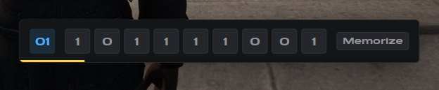<br><b>Binary Code</b> · <code>Binary</code><br><sub>Memorise a row of bits, then type it back. Hard reverses it and adds glitches.</sub></td>
<td width="33%" valign="top">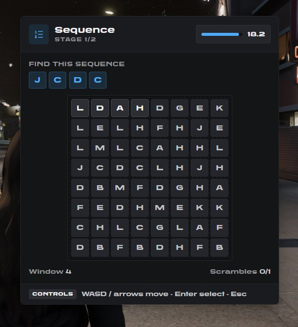<br><b>Sequence</b> · <code>Sequence</code><br><sub>Find the letter sequence hidden in a grid that keeps scrambling.</sub></td>
</tr>
<tr>
<td width="33%" valign="top">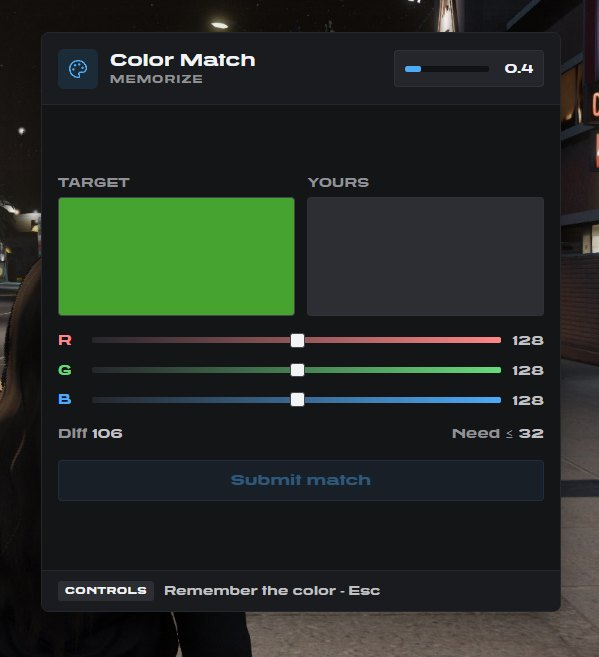<br><b>Color Match</b> · <code>ColorMatch</code><br><sub>Remember a colour, then mix it again with RGB sliders.</sub></td>
<td width="33%" valign="top">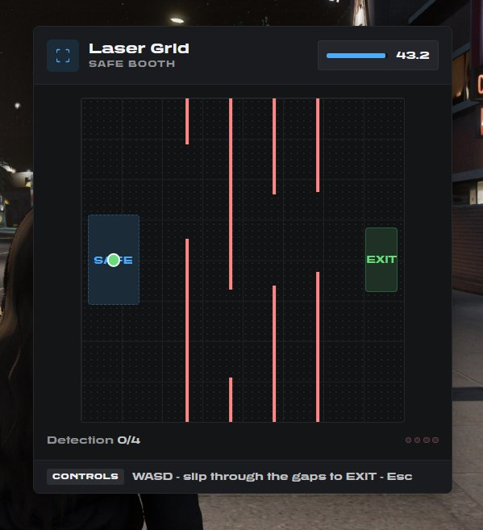<br><b>Laser Grid</b> · <code>LaserGrid</code><br><sub>Move through a room of sweeping lasers to the exit without being detected.</sub></td>
<td width="33%" valign="top">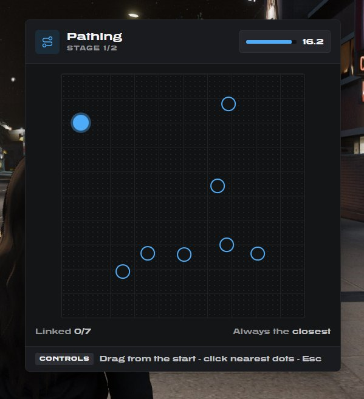<br><b>Pathing</b> · <code>Pathing</code><br><sub>Link the dots from the start, always to the closest one.</sub></td>
</tr>
<tr>
<td width="33%" valign="top">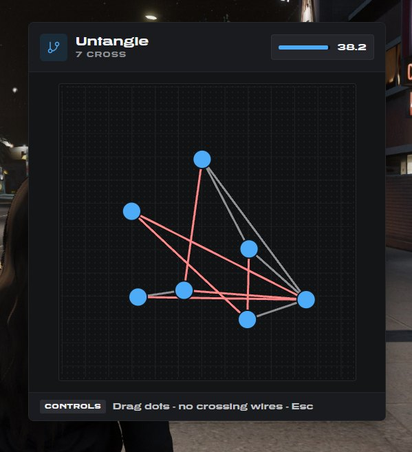<br><b>Untangle</b> · <code>Untangle</code><br><sub>Drag the dots until no wires cross.</sub></td>
<td width="33%" valign="top">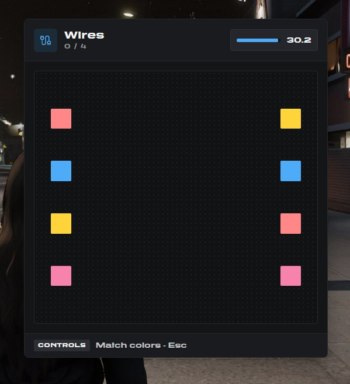<br><b>Wires</b> · <code>Wires</code><br><sub>Connect each wire to the terminal of the same colour.</sub></td>
<td width="33%" valign="top">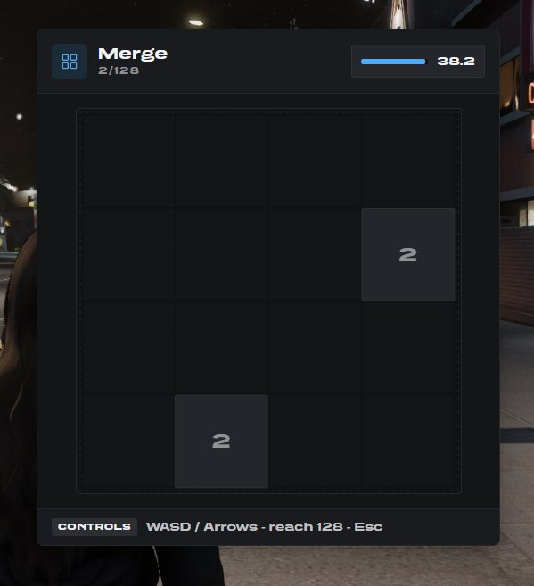<br><b>Merge</b> · <code>Merge</code><br><sub>Slide and merge tiles until you reach the target number.</sub></td>
</tr>
</table>

### Memory and puzzles

<table>
<tr>
<td width="33%" valign="top">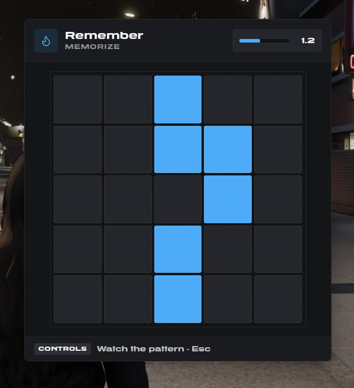<br><b>Remember</b> · <code>Remember</code><br><sub>Watch which cells light up, then click the same cells.</sub></td>
<td width="33%" valign="top"><br><b>Pairs</b> · <code>Pairs</code><br><sub>Flip cards and find every matching pair.</sub></td>
<td width="33%" valign="top">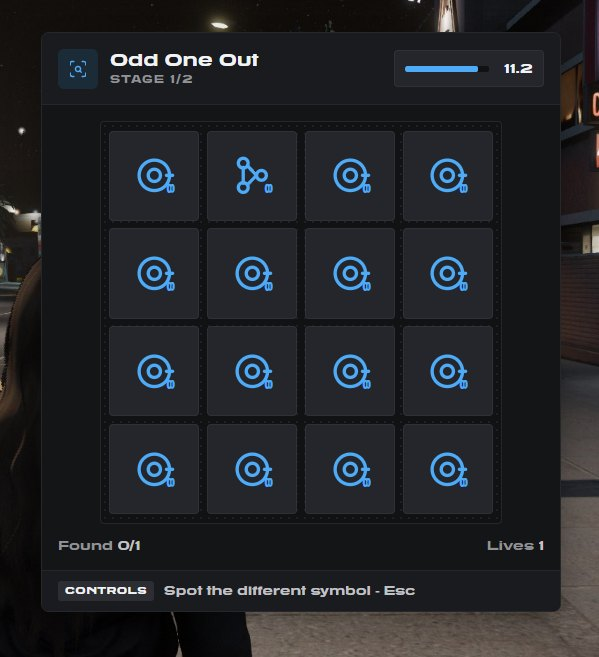<br><b>Odd One Out</b> · <code>OddOneOut</code><br><sub>Spot the symbol that is different from the rest.</sub></td>
</tr>
</table>

### Locks, safes and drills

<table>
<tr>
<td width="33%" valign="top">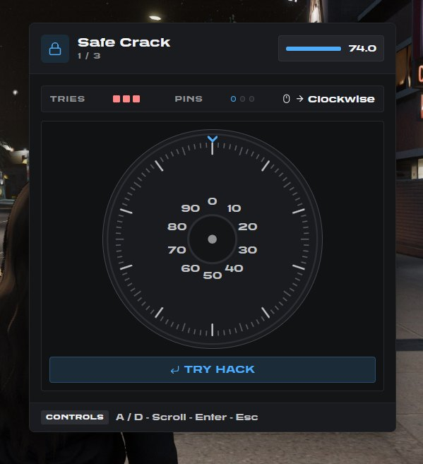<br><b>Safe Crack</b> · <code>SafeCrack</code><br><sub>Turn the dial and find each number of the combination.</sub></td>
<td width="33%" valign="top">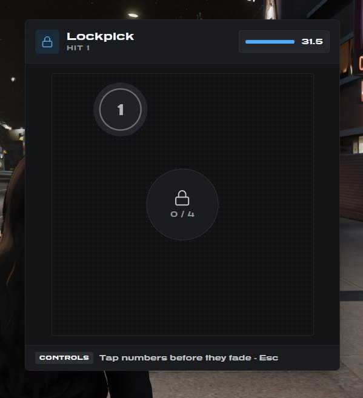<br><b>Lockpick</b> · <code>Lockpick</code><br><sub>Tap the numbered nodes in order before they fade.</sub></td>
<td width="33%" valign="top">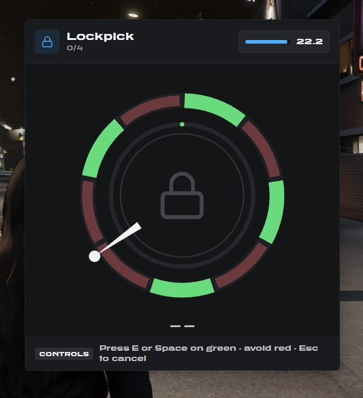<br><b>Lockpick V2</b> · <code>LockpickV2</code><br><sub>Press when the needle is on a green segment and avoid the red ones.</sub></td>
</tr>
<tr>
<td width="33%" valign="top">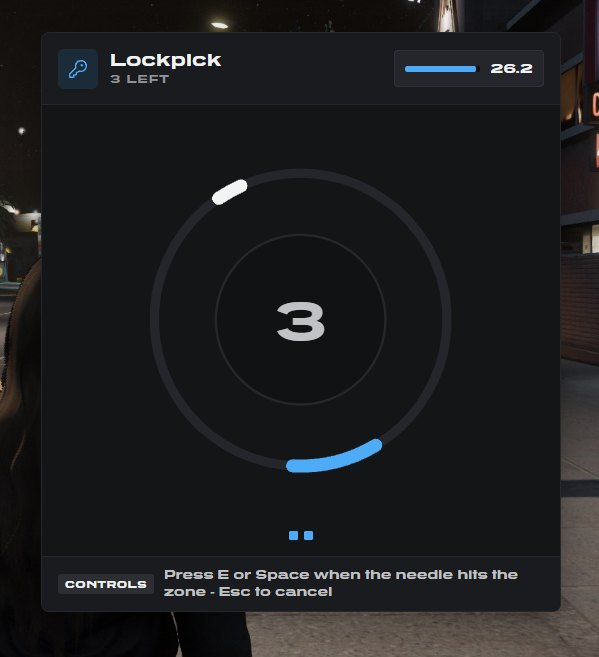<br><b>Circle Lock</b> · <code>CircleLock</code><br><sub>Press when the spinning needle hits the zone, several times in a row.</sub></td>
<td width="33%" valign="top">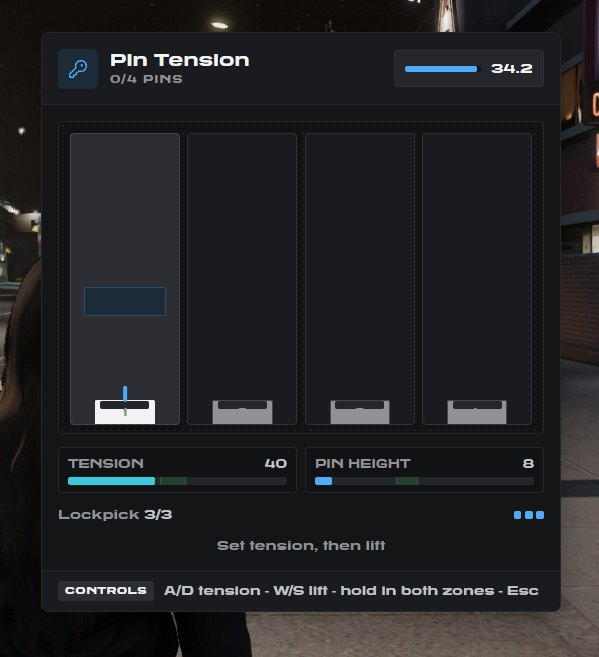<br><b>Pin Tension</b> · <code>PinTension</code><br><sub>Hold the tension and lift each pin until both are in their zones.</sub></td>
<td width="33%" valign="top">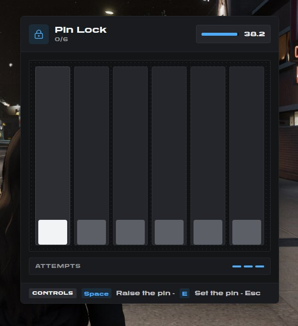<br><b>Pin Lock</b> · <code>PinLock</code><br><sub>Raise each pin against gravity and set it in the zone.</sub></td>
</tr>
<tr>
<td width="33%" valign="top">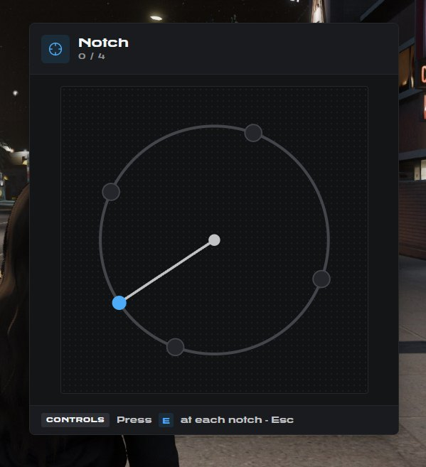<br><b>Notch</b> · <code>Notch</code><br><sub>Press as the rotating arm passes each notch.</sub></td>
<td width="33%" valign="top">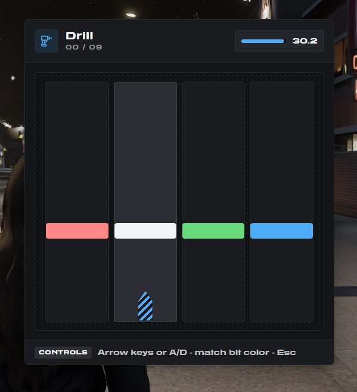<br><b>Drill</b> · <code>Drill</code><br><sub>Move the drill bit into the lane whose colour matches the falling bar.</sub></td>
<td width="33%" valign="top">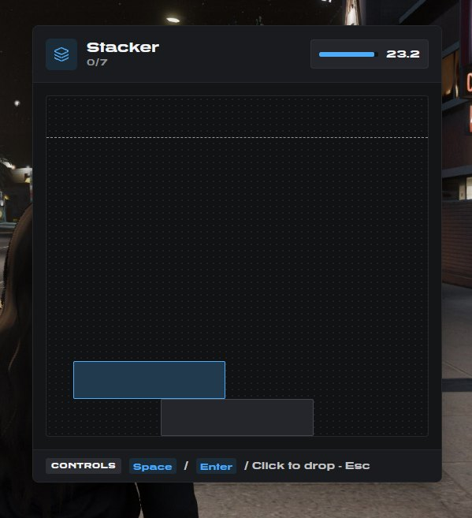<br><b>Stacker</b> · <code>Stacker</code><br><sub>Drop each moving block on the stack. Overhang is cut off.</sub></td>
</tr>
</table>

### Skill checks

<table>
<tr>
<td width="33%" valign="top">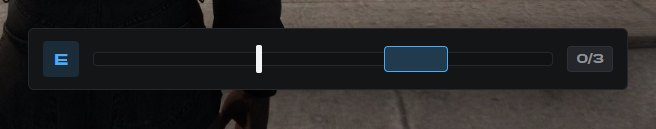<br><b>Skill Bar</b> · <code>SkillBar</code><br><sub>Press when the marker is inside the zone.</sub></td>
<td width="33%" valign="top">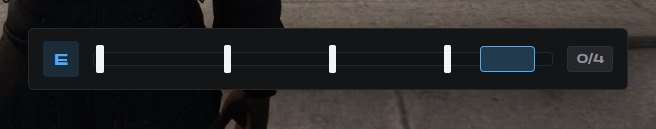<br><b>Pulse Bar</b> · <code>PulseBar</code><br><sub>Several markers cross the bar. Press as each one reaches the zone.</sub></td>
<td width="33%" valign="top">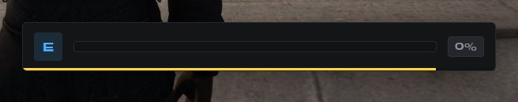<br><b>Smash</b> · <code>Smash</code><br><sub>Mash the key to fill the bar before it drains.</sub></td>
</tr>
<tr>
<td width="33%" valign="top">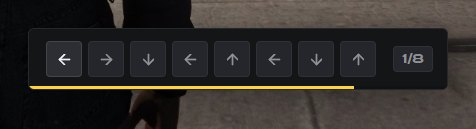<br><b>Arrows</b> · <code>Arrows</code><br><sub>Press the arrow sequence in order before time runs out.</sub></td>
<td width="33%" valign="top">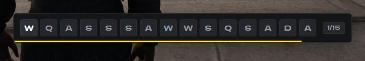<br><b>Alphabet</b> · <code>Alphabet</code><br><sub>Type the letters in order as fast as you can.</sub></td>
</tr>
</table>

### Looting (ox_inventory)

<table>
<tr>
<td width="33%" valign="top">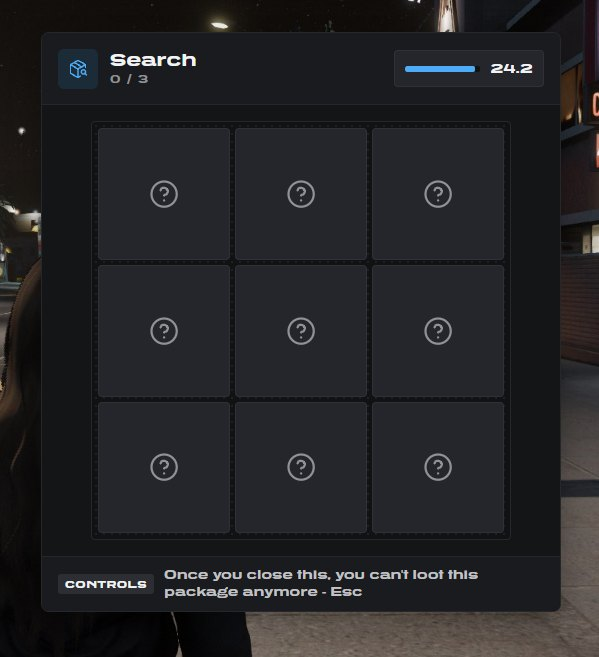<br><b>Search</b> · <code>Search</code><br><sub>Search boxes one by one. Items found go to the player through ox_inventory.</sub></td>
<td width="33%" valign="top">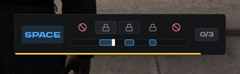<br><b>Ped Loot</b> · <code>PedLoot</code><br><sub>Grab each loot slot as the marker passes it and skip the empty ones.</sub></td>
</tr>
</table>

## Search and Ped Loot

Search and Ped Loot give items through ox_inventory. The **server decides what can be given**: call `AllowLoot` from your server script before you start the game on that player. The player can then receive up to those items from their next Search or Ped Loot, for 10 minutes. Anything the client asks for outside that list is ignored, so cheaters cannot give themselves items.

```lua
-- server.lua of your resource
RegisterNetEvent('myjob:searchCrate', function(crateId)
    local src = source
    -- your own checks first: distance, cooldown, job, crate not already looted
    local loot = {
        { item = 'lockpick', count = 1 },
        { item = 'money', count = 250 },
        { item = 'phone', count = 1 },
    }
    exports['at-lib']:AllowLoot(src, loot)
    TriggerClientEvent('myjob:openCrate', src, loot)
end)
```

```lua
-- client.lua of your resource
RegisterNetEvent('myjob:openCrate', function(loot)
    local ok, found = exports['at-lib']:Search({
        difficulty = 'medium',
        items = loot,
        required = 2,       -- slots to find to count as a success
        searchTime = 1400,  -- ms per box
        timeLimit = 26,     -- seconds
    })
    -- items are already in the inventory. ok is false on timeout or Esc,
    -- and found still lists what the player opened before that.
end)

local ok, found = exports['at-lib']:PedLoot({ difficulty = 'medium', slots = 5, empties = 2 })
```

| Export (server) | Parameters | Returns |
|-----------------|------------|---------|
| `AllowLoot` | `source, items` with `{ item, count?, metadata? }` | `boolean` |

- Pass `grantItems = false` to Search or Ped Loot to give nothing and handle the items yourself from the returned list.
- Metadata comes from the `AllowLoot` list, never from the client.
- For a quick test without server code, `setr at_lib_client_loot true` accepts the list the client sends, which is how rm-lib worked. Never turn it on for a live server: any player could give themselves any item.

## Dialogue

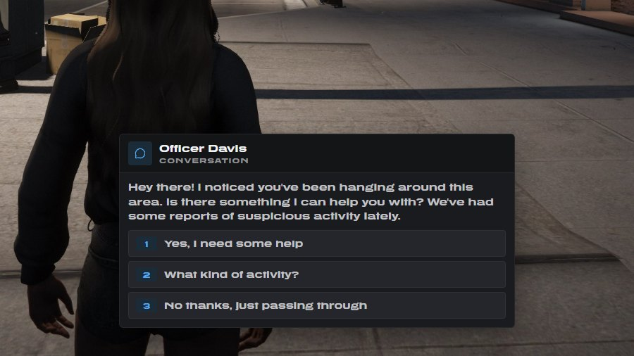

Opens a dialogue box and takes NUI focus. The callback gets the chosen option id, or `nil` when the player closes it.

| Export | Parameters | Returns |
|--------|------------|---------|
| `dialogue` | `data, cb?` | |
| `closeDialogue` | | |
| `isDialogueOpen` | | `boolean` |
| `getDialogue` | | current data or `nil` |

```lua
exports['at-lib']:dialogue({
    name = 'Officer Davis',
    text = 'We need your help with a case. Are you in?',
    ped = npcPed, -- optional, points a camera at this NPC
    options = {
        { id = 'accept', label = "Yes, I'm in" },
        { id = 'decline', label = 'Not right now' },
    },
}, function(optionId)
    if optionId == 'accept' then
        -- start the job
    end
end)
```

## Mission status

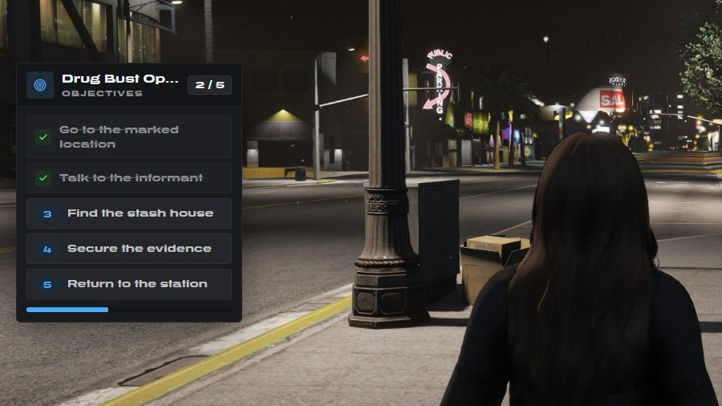

Left side panel with a title and a list of objectives. Does not take NUI focus.

| Export | Parameters |
|--------|------------|
| `setMission` | `data` |
| `updateObjective` | `objectiveId, completed` |
| `updateObjectives` | `objectives` |
| `closeMission` | |
| `getMission` | |
| `isMissionActive` | |

```lua
exports['at-lib']:setMission({
    title = 'Drug Bust Operation',
    objectives = {
        { id = 'goto', label = 'Go to the marked location', completed = false },
        { id = 'talk', label = 'Talk to the informant', completed = false },
    },
})

exports['at-lib']:updateObjective('goto', true)
exports['at-lib']:closeMission()
```

## Mission card

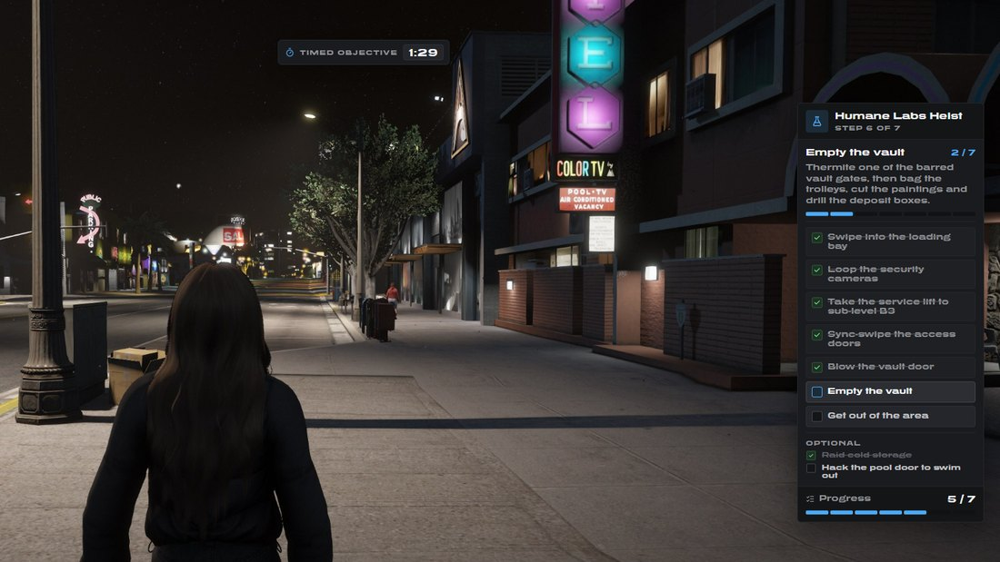

Compact card in the top right. It takes the same data as `setMission` and can be shown on its own or next to the panel.

| Export | Parameters |
|--------|------------|
| `setMissionCard` | `data` |
| `updateMissionCardDetails` | `data` |
| `updateObjectiveCard` | `objectiveId, completed` |
| `updateObjectivesCard` | `objectives` |
| `closeMissionCard` | |
| `getMissionCard` | |
| `isMissionCardActive` | |

| Field | Type | Description |
|-------|------|-------------|
| `title` | `string` | Mission title. |
| `objectives` | `table[]` | `{ id, label, completed }`. Required unless `steps` is given. |
| `steps` | `table[]?` | `{ id?, label, done?, active?, progress?, count? }`, replaces `objectives`. |
| `optional` | `table[]?` | `{ id?, label, done? }` under an Optional heading. |
| `task` | `string?` | Current step heading. |
| `detail` | `string?` | Current step description. |
| `meta` | `string?` | Line under the title, defaults to `Step X of N`. |
| `icon` | `string?` | Lucide icon name from `web/src/lib/icons.ts`. |
| `tasks` | `table[]?` | `{ id?, label, done?, progress?, count? }` checklist under the current step. |
| `badge` | `table?` | `{ icon?, text }` shown in the header. |
| `gauges` | `table[]?` | `{ id?, label?, icon?, kind = 'bar' \| 'segments' \| 'text', value?, max?, tone?, text?, ttl? }`. |
| `stat` | `table?` | `{ id?, label, value, icon?, format? = 'money' \| 'number' }` footer value. |
| `hint` | `string?` | Highlighted line at the bottom. |

`updateMissionCardDetails` accepts any of the fields above except `title` and `objectives`. `updateObjectiveCard` also matches `steps`, `tasks` and `optional` entries by id.

```lua
exports['at-lib']:setMissionCard({
    title = 'Delivery run',
    icon = 'truck',
    objectives = {
        { id = 'meet', label = 'Meet the buyer at the GPS mark', completed = false },
        { id = 'return', label = 'Return to the depot for payment', completed = false },
    },
})

exports['at-lib']:updateObjectiveCard('meet', true)
exports['at-lib']:closeMissionCard()
```

## Timers

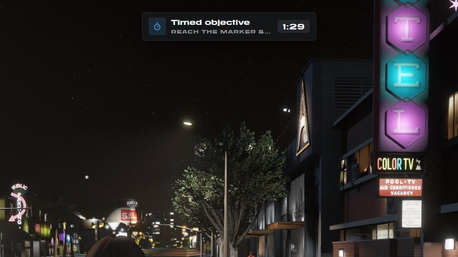

A top-centre countdown. The callback runs once when it reaches zero and does not run if you close the timer first.

| Export | Parameters |
|--------|------------|
| `showTimer` | `{ seconds, header?, text? }, cb?` |
| `updateTimer` | `{ seconds?, header?, text? }` |
| `closeTimer` | |

```lua
exports['at-lib']:showTimer({
    seconds = 300,
    header = 'Timed objective',
    text = 'Reach the drop-off before time runs out.',
}, function()
    exports['at-lib']:closeMission()
end)

exports['at-lib']:updateTimer({ seconds = 120, text = 'Two minutes left' })
exports['at-lib']:closeTimer()
```

The heist timer is a compact `MM:SS` display that sits above the mission card:

```lua
exports['at-lib']:showTimedObjectiveV2({ seconds = 35 * 60 }, function()
    print('Heist time expired')
end)

exports['at-lib']:updateTimedObjectiveV2({ seconds = 120 })
exports['at-lib']:closeTimedObjectiveV2()
```

## Progress bar

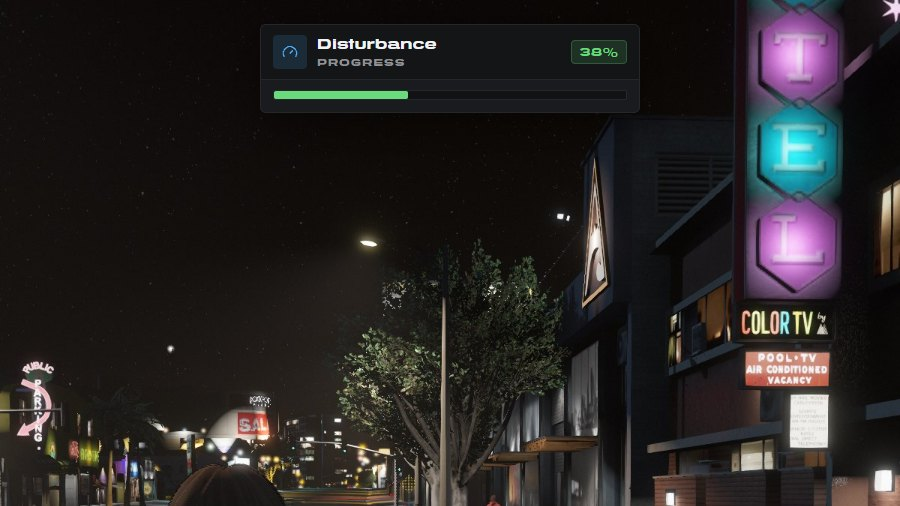

Bottom-centre bar from 0 to 100.

```lua
exports['at-lib']:showProgress({ progress = 25, header = 'Suspicion', label = 'Stay out of sight' })
exports['at-lib']:updateProgress({ progress = 80 })
exports['at-lib']:closeProgress()
```

## TextUI

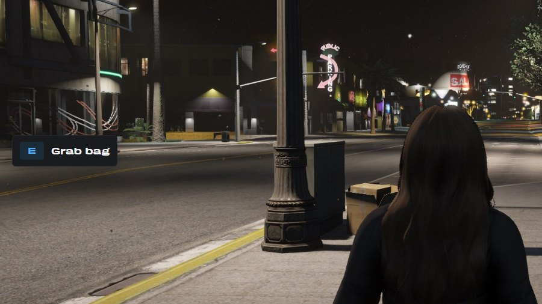

Key prompt on the right side of the screen. Does not take NUI focus.

```lua
exports['at-lib']:showTextUI('E', 'Grab bag')      -- key and label
exports['at-lib']:showTextUI('Hold to search')     -- plain label, no key
local open = exports['at-lib']:isTextUIOpen()
exports['at-lib']:hideTextUI()
```

## Gang zone

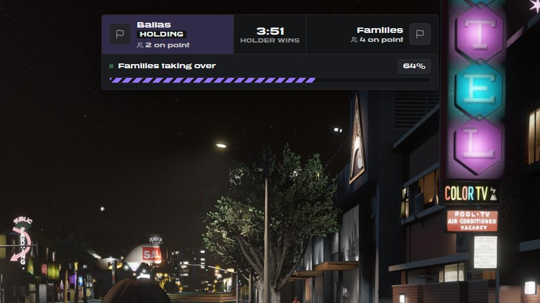

Top-centre capture card. The side that owns or is capturing the zone gets its gang colour, and `owner = nil` shows the zone as contested.

```lua
exports['at-lib']:showGangZone({
    percent = 40,
    seconds = 90,
    left = { name = 'Ballas', logo = 'https://example.com/ballas.png', color = '#7b2fbe' },
    right = { name = 'Families', color = '#2f9e44' },
    owner = 'left',
})

exports['at-lib']:updateGangZone({ percent = 55, seconds = 75 })
exports['at-lib']:closeGangZone()
```

## World cards

A small icon and label drawn by the game at a world position or on an entity, visible within `distance` metres.

```lua
local id = exports['at-lib']:addWorldCard({
    coords = vec3(x, y, z),    -- or entity = vehicle, offset = vec3(0.0, -4.0, 1.2)
    label = 'Locked',
    icon = 'lock',             -- lock, lock-open, trash-2, truck, banknote, trees, hard-hat, package, check, user
    color = 'red',             -- red, green, blue, orange or grey
    distance = 2.0,
    showWhileMoving = false,   -- vehicle cards hide while driving unless true
})

exports['at-lib']:updateWorldCard(id, { label = 'Unlocked', icon = 'lock-open', color = 'green' })
exports['at-lib']:removeWorldCard(id)
```

## Helpers

```lua
local ped = exports['at-lib']:getPlayerPed() -- cache.ped from ox_lib
```

## Dev tools

```bash
setr at_minigames_dev true
```

With the convar on, `/minigames` opens a picker with every game and difficulty, and `/test<game> [easy|medium|hard]` runs one game, for example `/testarrows hard`. Exports always work: only the commands are gated.

`InitializeSafe(combination, startDirection)` followed by `RunMiniGame()` is also available for scripts written for other safe-cracking resources.

## Tutorial: a store robbery

This walks through a small store robbery that uses most of at-lib: a dialogue to start it, a mission card with a heist timer, a key prompt and a lockpick at the door, a world card and a safe crack at the safe, a noise bar, and a search that gives real items. Copy the pieces you need.

### 1. Start the job from an NPC

```lua
-- client.lua
local function startJob(npc)
    exports['at-lib']:dialogue({
        name = 'Vince',
        text = 'The store on Grove Street keeps cash in the back. Ten minutes, in and out. You in?',
        ped = npc, -- puts a camera on the NPC
        options = {
            { id = 'yes', label = "I'm in" },
            { id = 'no', label = 'Not today' },
        },
    }, function(choice)
        if choice ~= 'yes' then return end
        TriggerEvent('robbery:begin')
    end)
end
```

### 2. Show the mission and a timer

```lua
AddEventHandler('robbery:begin', function()
    exports['at-lib']:setMissionCard({
        title = 'Grove Street store',
        icon = 'landmark',
        task = 'Get inside',
        detail = 'The back door is on the alley side.',
        objectives = {
            { id = 'door', label = 'Pick the back door', completed = false },
            { id = 'safe', label = 'Crack the safe', completed = false },
            { id = 'stash', label = 'Search the stash', completed = false },
            { id = 'leave', label = 'Get away', completed = false },
        },
        hint = 'Stay quiet: noise brings the police.',
    })

    exports['at-lib']:showTimedObjectiveV2({ seconds = 10 * 60 }, function()
        exports['at-lib']:closeMissionCard()
        exports['at-lib']:closeProgress()
        lib.notify({ type = 'error', description = 'Too slow. The job is off.' })
    end)

    exports['at-lib']:showProgress({ progress = 0, header = 'Noise', label = 'Stay out of sight' })
end)
```

### 3. A key prompt and a lockpick at the door

```lua
local door = vec3(-47.4, -1758.6, 29.4)

local function pickDoor()
    exports['at-lib']:hideTextUI()
    if exports['at-lib']:LockpickV2({ difficulty = 'medium' }) then
        exports['at-lib']:updateObjectiveCard('door', true)
        exports['at-lib']:updateMissionCardDetails({ task = 'Find the safe', detail = 'It is in the office.' })
    else
        exports['at-lib']:updateProgress({ progress = 35 })
    end
end

lib.points.new({
    coords = door,
    distance = 1.5,
    onEnter = function() exports['at-lib']:showTextUI('E', 'Pick the lock') end,
    onExit = function() exports['at-lib']:hideTextUI() end,
    nearby = function()
        if IsControlJustReleased(0, 38) then pickDoor() end
    end,
})
```

### 4. A world card and a safe crack

```lua
local safe = vec3(-43.4, -1748.3, 29.4)
local card = exports['at-lib']:addWorldCard({
    coords = safe,
    label = 'Safe',
    icon = 'lock',
    color = 'orange',
    distance = 3.0,
})

local function crackSafe()
    if exports['at-lib']:SafeCrack({ difficulty = 'hard', timeLimit = 90 }) then
        exports['at-lib']:updateWorldCard(card, { label = 'Open', icon = 'lock-open', color = 'green' })
        exports['at-lib']:updateObjectiveCard('safe', true)
        TriggerServerEvent('robbery:searchStash')
    else
        exports['at-lib']:updateProgress({ progress = 70 })
    end
end
```

### 5. Give real items with Search

The server decides the loot and allows it, then tells the client to start the search.

```lua
-- server.lua
RegisterNetEvent('robbery:searchStash', function()
    local src = source
    -- check the player is at the store and the job is active before giving anything
    local loot = {
        { item = 'money', count = math.random(800, 1500) },
        { item = 'goldbar', count = 1 },
        { item = 'phone', count = 1 },
    }
    exports['at-lib']:AllowLoot(src, loot)
    TriggerClientEvent('robbery:openStash', src, loot)
end)
```

```lua
-- client.lua
RegisterNetEvent('robbery:openStash', function(loot)
    local ok = exports['at-lib']:Search({ difficulty = 'medium', items = loot, required = 2 })
    exports['at-lib']:updateObjectiveCard('stash', true)
    exports['at-lib']:removeWorldCard(card)
end)
```

### 6. Finish

```lua
local function finish()
    exports['at-lib']:updateObjectiveCard('leave', true)
    exports['at-lib']:closeTimedObjectiveV2()
    exports['at-lib']:closeProgress()
    SetTimeout(3000, function() exports['at-lib']:closeMissionCard() end)
end
```

The same pattern works for any job: open with `dialogue`, track it with `setMissionCard` or `setMission`, gate each step with a minigame, and close everything when it ends.

## Building the UI

Only needed if you change the Svelte source in `web/src`.

```bash
cd web
pnpm install
pnpm run build
```

`pnpm start` runs a browser dev server on port 3001 with a dev menu and mock data for every game and HUD piece. `pnpm run start:game` rebuilds on every save so you can restart the resource in game.

## Moving from rm-lib

at-lib is the renamed rm-lib. The exports and their arguments are the same, so replace `exports['rm-lib']` with `exports['at-lib']` and `dependency 'rm-lib'` with `dependency 'at-lib'` in your resources. The internal events are now `at-lib:*`, and the dev convar is `at_minigames_dev`.

One change in behaviour: Search and Ped Loot only give items that a server script allowed with `AllowLoot`. See Search and Ped Loot above.

## License

MIT. See [LICENSE](LICENSE).
